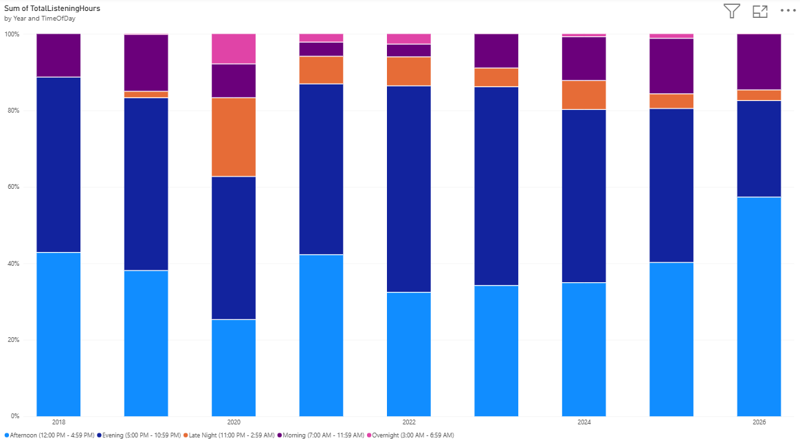

# Spotify Listening History Analysis
### **Overview** 
This is a SQL analysis of my personal Spotify streaming history going back to 2018. I will be exploring my listening habits and trends.

## Table of Contents
- [Overview](#overview)
- [Tools Used](#tools-used)
- [Data Discovery](#data-discovery)
- [Data Cleaning And Formatting](#data-cleaning-and-formatting)
- [Loading Data into MS SQL Server](#loading-data-into-ms-sql-server)
- [Data Analysis](#data-analysis)
- [Final Thoughts](#final-thoughts)

### **Tools Used:** 
MS Excel \
SQL Server Management Studio 22 \
Power BI


### **Data Discovery** 
Spotify allows users to request a copy of their personal data through its Privacy page. I went to the Spotify Privacy page and selected 'Download Your Data'. A week or two later, I received an email from Spotify with my Extended Streaming History data files. I downloaded the ZIP files, and found the data files in JSON format broken up year by year. I converted the streaming_history_audio files from JSON format to CSV using Excel. \
\
In Excel, I followed these steps to import each JSON file to Excel:
1. Get Data > From File > From JSON > Streaming_History_Audio_20XX
2. Select ‘To table’ in power query editor
3. Expand the column header to select fields I want to retain. \
   Columns I will be using: ts, ms_played, master_metadata_track_name, master_metadata_artist_album_name, master_metadata_album_name, spotify_track_uri, reason_start, reason_end, shuffle, skipped, offline, offline_timestamp
4. Close and Load to Table in existing worksheet

### **Data Cleaning And Formatting**
- Align all columns to the left
- Autofit column width so all data is fully visible
- Rename column headers to be easily understood
- Convert 'offline_timestamp' units to Unix timestamp in seconds. 
- Ensure all data files imported are being filtered together

All 9 JSON data files were combined to 1 Excel worksheet in CSV format called 'straming_history', with 12 columns and 37,712 rows after being cleaned. 
\
\
### **Loading Data into MS SQL Server** 
1. Create a database called `SpotifyStreamingHistory`.
2. Create a table called `streaming_history_staging` with 12 fields, assigning the correct data type to each field.
   ```sql
   CREATE TABLE streaming_history_staging (
       [timestamp] NVARCHAR(100),
       msPlayed INT,
       trackName NVARCHAR(MAX),
       artistName NVARCHAR(MAX),
       albumName NVARCHAR(MAX),
       trackUri NVARCHAR(500),
       reasonStart NVARCHAR(100),
       reasonEnd NVARCHAR(100),
       shuffle NVARCHAR(20),
       skipped NVARCHAR(20),
       offline NVARCHAR(20),
       offline_timestamp NVARCHAR(50)
   );
   ```
3. Import the `streaming_history` CSV using Tasks > Import Flat File. Specify the file location, table name (`streaming_history_staging`), preview the data, and import it.
4. Run a `SELECT` query to verify the data loaded correctly.
   ```sql
   SELECT * FROM dbo.streaming_history_staging;
   ```

### **Data Analysis** 
This query sums up the top songs I've spent the most time listening to, sorting them in descending order. \
\
The `GROUP BY` clause groups rows with the same values (the track and artist names), so the aggregate function `SUM(msPlayed)` can be applied to each group separately. 
```sql
SELECT TOP 5 trackName, artistName, SUM(msPlayed) /60000 AS TotalMinutes FROM dbo.streaming_history_staging
WHERE trackName IS NOT NULL
GROUP BY trackName, artistName
ORDER BY TotalMinutes DESC;
```
### My Top 5 Most Played Songs of All Time
| Rank | Track | Artist | Total Minutes |
|---:|---|---|---:|
| 1 | Breakfast At Tiffany's | Deep Blue Something | 401 |
| 2 | Smells Like Teen Spirit | Nirvana | 391 |
| 3 | Cigarette Daydreams | Cage The Elephant | 384 |
| 4 | Trouble | Cage The Elephant | 335 |
| 5 | On Top | The Killers | 321 |

Thinking back, this does make sense. I used to LOVE The Killers and Cage The Elephant when I was 16 and definitely overplay the same songs again and again at work. \
\
I do vaguely remember Breakfast At Tiffany's being one of the first songs I ever added to a playlist on Spotify. I believe at that time, I hadn't found the recommended songs algorithm and would just listen back to the same playlist over and over again. \
\
When I was 19, I got really into Nirvana. I remember I would solely listen to Nirvana albums on my walk back home from the restaurant I worked at. Of course, Smells Like Teen Spirit always came back to me. I did have a strong bias to the song Lithium off the Nevermind album. I'm surprised I don't see that one up there. 


### **My Top Songs in 2018** 
Going as far back as my listening history takes me, we arrive in 2018. For context, I was 16-17 years old, had just downloaded Spotify, and was probably acting like an angsty teen listening to music as I stocked groceries after school. \
\
This query isolates the top 3 songs I spent the most time listening to in the year 2018.
```sql
SELECT TOP 3 trackName, artistName, SUM(msPlayed) /60000 AS TotalMinutes FROM dbo.streaming_history_staging
WHERE trackName IS NOT NULL AND timestamp LIKE '2018%'
GROUP BY trackName, artistName
ORDER BY TotalMinutes DESC;
```
| Rank | Track | Artist | Total Minutes |
|---:|---|---|---:|
| 1 | CIA | New Politics | 89 |
| 2 | Spirits | The Strumbellas | 78 |
| 3 | Breakfast At Tiffany's | Deep Blue Something | 75 |

I would describe these songs as belonging to the alternative/indie pop-rock genre. It was dipping a toe into the alt music space with upbeat and catchy tracks that weren't particularly aggressive. 

### **My Top Songs in 2021**
Let's skip forward a few years to 2021 and see if my music taste has diversified at all. At this time, I was around 19-20 years old and was working at a restaurant/bar as a waitress while commuting to my local university. Times had indeed changed for me, so I'm sure my music taste had as well. \
\
I'm using the same query as before, but with the LIKE operator with the `%` wildcard to include timestamps of songs I listened to only in 2021.
```sql
SELECT TOP 3 trackName, artistName, SUM(msPlayed) /60000 AS TotalMinutes FROM dbo.streaming_history_staging
WHERE trackName IS NOT NULL AND timestamp LIKE '2021%'
GROUP BY trackName, artistName
ORDER BY TotalMinutes DESC;
```
| Rank | Track | Artist | Total Minutes |
|---:|---|---|---:|
| 1 | Shine On You Crazy Diamond (Pts. 1-5) | Pink Floyd | 81 |
| 2 | Heart-Shaped Box | Nirvana | 79 |
| 3 | CORALINE | Måneskin | 75 |

My music taste appears to have shifted to more progressive and heavier rock, while still staying in the alternative/grunge space. 90's music is one of my favorite eras of music, giving us so many hits from the likes of Nirvana, Sonic Youth and Hole, so I'm not surprised a Nirvana track made the list. Pink Floyd's music is timeless, so it's no wonder it was my top song this year.

I also listened to a lot of Måneskin this year, right after the band blew up after winning the 2021 Eurovision Song Contest. I think it's also worth noting that my attachment to my favorite songs didn't seem to change much between 2018 and 2021. My top three songs accumulated almost exactly the same amount of listening time in both years. 

### **My Top Songs in 2025**
We finally arrive at 2025, the latest full calendar year of my listening history at the time of this analysis. A few years have passed again, making me 23-24 years old here. During this time, I completed my final year of university, and started my first full-time job. 
```sql
SELECT TOP 3 trackName, artistName, SUM(msPlayed) /60000 AS TotalMinutes FROM dbo.streaming_history_staging
WHERE trackName IS NOT NULL AND timestamp LIKE '2025%'
GROUP BY trackName, artistName
ORDER BY TotalMinutes DESC;
```
| Rank | Track | Artist | Total Minutes |
|---:|---|---|---:|
| 1 | Change (In the House of Flies) | Deftones | 143 |
| 2 | King For A Day | Pierce The Veil | 133 |
| 3 | Kids | Current Joys | 128 |

Fast forward to 2025, it appears my music taste is leaning further into the alternative music scene reflecting my love for darker and more emotional music. But, it also looks like I'm still enjoying my fair share of melodic music with Current Joys. I spent 67% more listening time on these 3 top tracks compared to the previous years we looked at. At first, I believed that this may have been due to an increase of overall listening time in 2025. \
\
I constructed this query to test this theory, looking at my total listening hours year by year.
```sql
SELECT YEAR(timestamp) AS Years, FORMAT(SUM(msPlayed) / 3600000.0, '0.##') AS TotalHours FROM dbo.streaming_history_staging
GROUP BY YEAR(timestamp)
ORDER BY YEAR(timestamp)
```
**My Total Listening Hours Per Year**
| Year | Total Listening Hours |
|---:|---:|
| 2018 | 36.31 |
| 2019 | 441.49 |
| 2020 | 292.48 |
| 2021 | 185.01 |
| 2022 | 154.13 |
| 2023 | 183.48 |
| 2024 | 274.16 |
| 2025 | 103.33 |

Surprisingly, the results didn't support my initial theory. Despite spending significantly more time replaying my top three songs in 2025, my overall listening time was only 103.33 hours, considerably lower than the previous year. In fact, 2024 had nearly three times as many listening hours.

This suggests that my increased replay time for my top 3 favorite tracks in 2025 wasn't the result of listening to more music overall. Instead, I was spending a greater proportion of my listening time revisiting a smaller selection of favorite songs.


### **How Often Did I Hit Skip?**

After looking at my total listening hours each year, I wanted to get a better understanding of how my listening habits changed over time. Total listening hours alone don't tell the whole story. For example, spending more time listening to music doesn't necessarily mean I was listening to more individual tracks or letting songs play for longer.

I expanded my query to calculate four metrics for each year: total listening hours, total records streamed, average playback time per record, and the percentage of records I skipped.

I constructed this query using a `CASE` expression that lets me apply conditional logic. If the reason a track ended `reasonEnd` was because of a Forward Skip `fwdbtn`, then these tracks are summed together and expressed as a percentage of all tracks grouped by each year.

```sql
SELECT YEAR(timestamp) AS Year, FORMAT(SUM(msPlayed) / 3600000.0, '0.##') AS TotalListeningHours, COUNT(timestamp) AS TotalStreams, FORMAT((SUM(msPlayed) /60000.0) / COUNT(timestamp),'0.##') AS AvgListeningMinutes,
    FORMAT(
        SUM(CASE WHEN reasonEnd = 'fwdbtn' THEN 1.0 ELSE 0 END)
        / COUNT(*), '0.##%'
    ) AS SkipPercentage FROM dbo.streaming_history_staging
GROUP BY YEAR(timestamp)
ORDER BY YEAR(timestamp)
```

**My Annual Forward-Skip Percentage**
| Year | Total Listening Hours | Total Streams | Avg. Listening Minutes | Skip Percentage |
|---:|---:|---:|---:|---:|
| 2018 | 36.31 | 695 | 3.13 | 4.89% |
| 2019 | 441.49 | 7,399 | 3.58 | 4.47% |
| 2020 | 292.48 | 5,433 | 3.23 | 6.72% |
| 2021 | 185.01 | 3,008 | 3.69 | 0.57% |
| 2022 | 154.13 | 2,591 | 3.57 | 5.67% |
| 2023 | 183.48 | 5,372 | 2.05 | 26.81% |
| 2024 | 274.16 | 9,902 | 1.66 | 36.57% |
| 2025 | 103.33 | 2,043 | 3.03 | 0.93% |

What's particularly interesting is that my listening habits don't appear to have changed in a linear direction. I initially assumed that as I got older, my music taste would continue expanding and diversifying. However, the data suggests something a little different.

Between 2023 and 2024, I seemed to experiment with music more frequently, potentially spending more time discovering new artists and skipping through songs. By 2025, my listening behavior had shifted again, with fewer skips and more time spent revisiting songs I particularly enjoyed.

Perhaps my relationship with music has become less about constantly finding something new and more about appreciating the songs I already know I love.

### **When Do I Listen to Music?**
This query was a bit more complex. I used a CTE to organize the data and convert Spotify's UTC timestamps into my local Eastern Time using `AT TIME ZONE`. I then used `DATEPART` to extract the hour from each timestamp and a `CASE` statement to categorize each listening record into five time periods: late night, overnight, morning, afternoon, and evening.

Finally, I grouped the records by time of day and used `SUM` to calculate the total listening hours for each category. I also converted `msPlayed` to `BIGINT` before summing to prevent an arithmetic overflow, and used an `ORDER BY CASE` to display the results in chronological order.

```sql
WITH ListeningData AS (
    SELECT
        CASE
            WHEN DATEPART(HOUR, LocalTimestamp) IN (23, 0, 1, 2)
                THEN 'Late Night (11:00 PM - 2:59 AM)'
            WHEN DATEPART(HOUR, LocalTimestamp) BETWEEN 3 AND 6
                THEN 'Overnight (3:00 AM - 6:59 AM)'
            WHEN DATEPART(HOUR, LocalTimestamp) BETWEEN 7 AND 11
                THEN 'Morning (7:00 AM - 11:59 AM)'
            WHEN DATEPART(HOUR, LocalTimestamp) BETWEEN 12 AND 16
                THEN 'Afternoon (12:00 PM - 4:59 PM)'
            WHEN DATEPART(HOUR, LocalTimestamp) BETWEEN 17 AND 22
                THEN 'Evening (5:00 PM - 10:59 PM)'
        END AS TimeOfDay,
        msPlayed,
        timestamp
    FROM (
        SELECT *,
            CAST(timestamp AS DATETIMEOFFSET)
                AT TIME ZONE 'Eastern Standard Time' AS LocalTimestamp
        FROM dbo.streaming_history_staging
    ) AS ConvertedTimestamps
)

SELECT
    TimeOfDay,
    FORMAT(SUM(CAST(msPlayed AS BIGINT)) / 3600000.0, '0.##') AS TotalListeningHours
FROM ListeningData
GROUP BY TimeOfDay
ORDER BY
    CASE TimeOfDay
        WHEN 'Late Night (11:00 PM - 2:59 AM)' THEN 1
        WHEN 'Overnight (3:00 AM - 6:59 AM)' THEN 2
        WHEN 'Morning (7:00 AM - 11:59 AM)' THEN 3
        WHEN 'Afternoon (12:00 PM - 4:59 PM)' THEN 4
        WHEN 'Evening (5:00 PM - 10:59 PM)' THEN 5
    END;
```
### Total Listening Hours by Time of Day

| Time of Day | Total Listening Hours |
|---|---:|
| Late Night (11:00 PM - 2:59 AM) | 128.14 |
| Overnight (3:00 AM - 6:59 AM) | 36.48 |
| Morning (7:00 AM - 11:59 AM) | 179.27 |
| Afternoon (12:00 PM - 4:59 PM) | 618.58 |
| Evening (5:00 PM - 10:59 PM) | 767.57 |


The results show that most of my listening happens in the afternoon and evening. Together, these two periods account for approximately 80% of my total listening time. Evening is my most active listening period, with 767.57 hours, followed by the afternoon with 618.58 hours.

My morning listening is considerably lower, at 179.27 hours. I found this result a little surprising. I expected my morning listening hours to be higher since I usually like to put on a song while I'm showering, but this habit must not be as consistent as I imagined. 

An interesting takeaway is that I'm not necessarily the late-night listener I might have expected. My listening is much more concentrated between noon and 11 PM.

Using Power BI to import my SQL query from MS SQL Server allowed me to visualize the data and identify trends more clearly by comparing by data year to year. Looking at the last three years, I can see a gradual shift in my listening habits away from evening listening and toward morning and afternoon listening.



### **Final Thoughts**

Looking back at my Spotify listening history, it's interesting to see how my relationship with music has evolved over the years. My music taste has shifted from alternative and indie pop-rock toward heavier and darker genres, while certain favorite songs have remained consistently important to me.

My listening behavior has also changed. I went through periods of more frequent skipping and experimentation, followed by a return to revisiting familiar favorites. More recently, I've also noticed a gradual shift in when I listen to music, with afternoon and morning listening becoming more prominent relative to evening listening.

This project gave me an opportunity to explore my personal listening history using SQL and Power BI, while discovering patterns I wouldn't have noticed otherwise. It was also a great way to practice querying, aggregating, cleaning, and visualizing real-world data while learning more about myself!

Thank you for reading!
